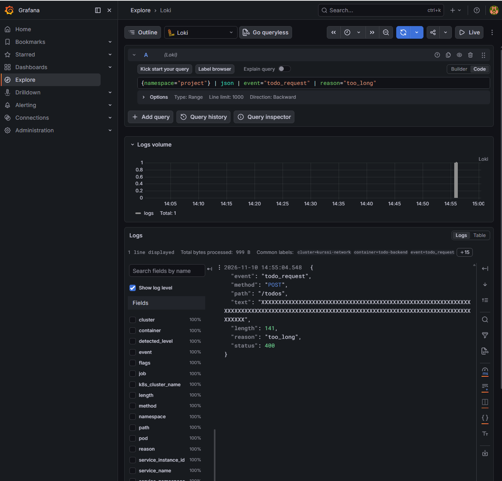

## 2.10 – The project, step 13

Todo Backend kirjoittaa `POST /todos` -pyynnöistä JSON-lokin. Lokissa näkyvät lähetetty teksti, sen pituus, käsittelyn tulos ja HTTP-tilakoodi. Alloy kerää lokit Lokiin, josta ne voi hakea Grafanan Explore-näkymässä.

Curl-testissä lyhyt tehtävä palautti `201 Created`. Backend hylkäsi 141 merkin tehtävän vastauksella `400 Bad Request` ja kirjasi hylkäyksen syyksi `too_long`.

```logql
{namespace="project"} | json | event="todo_request" | reason="too_long"
```


