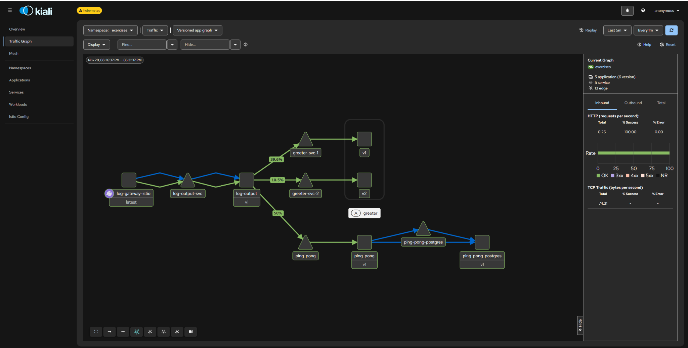

# 5.3 Log app, the Service Mesh Edition

Log output -sovellus otettiin käyttöön Istio ambient -meshissä.
Sovellukseen lisättiin greeter-palvelu, jonka tervehdys näytetään
muun lokitulosteen yhteydessä.

## Ympäristö

- Paikallinen k3d-klusteri: `istio-lab`
- Kubernetes-konteksti: `k3d-istio-lab`
- Namespace: `exercises`
- Istio ambient ja namespacekohtainen waypoint
- Prometheus ja Kiali tehtävän 5.2 asennuksesta

## Toteutus

Log output hakee ping-pong-laskurin sekä tervehdyksen greeter-palvelusta.
Greeterin osoite asetetaan ympäristömuuttujalla:

```text
GREETER_URL=http://greeter-svc/
```

Greeterillä on kaksi Deploymentia ja versiokohtaiset tervehdykset:

- `greeter-v1`: `Hello from greeter v1`
- `greeter-v2`: `Hello from greeter v2`

Palvelut ovat:

| Service | Tehtävä |
| --- | --- |
| greeter-svc | Log outputin käyttämä yhteinen osoite |
| greeter-svc-1 | Valitsee greeter v1 -podit |
| greeter-svc-2 | Valitsee greeter v2 -podit |

HTTPRoute liitetään `greeter-svc`-Serviceen parentRefs-määrityksellä.
Waypoint ohjaa liikenteen backend-palveluille painoilla:

- `greeter-svc-1`: 75
- `greeter-svc-2`: 25

Ping-pong käyttää PostgreSQL-tietokantaa, jonka tiedot tallennetaan
paikalliseen persistent volumeen.

## Käyttöönotto

Edellytyksenä on [tehtävän 5.2 Istio-asennus](../5.2/README.md).

Suorita repositorion juuresta:

```powershell
powershell.exe -NoProfile -ExecutionPolicy Bypass `
    -File .\service-mesh\5.3\deploy.ps1
```

Skripti rakentaa ja tuo konttikuvat k3d-klusteriin,
luo tarvittaessa tietokannan Secretin sekä ottaa määritykset käyttöön.

Avaa port-forward:

```powershell
kubectl --context=k3d-istio-lab -n exercises `
    port-forward svc/log-gateway-istio 8085:80
```

Sovelluksen osoite: http://localhost:8085/log

Tuloste sisältää esimerkiksi:

```text
file content: this text is from file
env variable: MESSAGE=hello from Istio 5.3
2026-11-20T16:25:54.579Z: 82faf41c-270d-4503-888c-f18390e72ecf
Ping / Pongs: 0
Greeting: Hello from greeter v1
```

## Liikenteenjaon testaus

Testi suoritetaan port-forwardin ollessa käynnissä:

```powershell
powershell.exe -NoProfile -ExecutionPolicy Bypass `
    -File .\service-mesh\5.3\test-traffic.ps1
```

200 pyynnön testiajon tulos:

| Versio | Pyyntöjä | Osuus |
| --- | --- | --- |
| v1 | 161 | 80,5 % |
| v2 | 39 | 19,5 % |

Jako on satunnainen, joten yksittäisen testiajon osuudet
vaihtelevat määritetyn 75/25-painotuksen ympärillä.

## Varmistus Kialissa

Kialissa valittiin:

- Traffic Graph
- Namespace `exercises`
- Versioned app graph
- Display → Traffic Distribution

Kuva näyttää molemmat greeter-versiot ja niiden liikenteen.



Kuvakaappauksessa Log outputin lähtevistä pyynnöistä noin 50 %
menee ping-pongille, 39,6 % greeter v1:lle ja 10,5 % greeter v2:lle.
Greeter-liikenteestä osuudet ovat siten noin 79 % ja 21 %.

Kialin tarkasteluikkuna ja testiskriptin otos kattavat eri pyynnöt,
joten niiden prosentit voivat erota toisistaan.