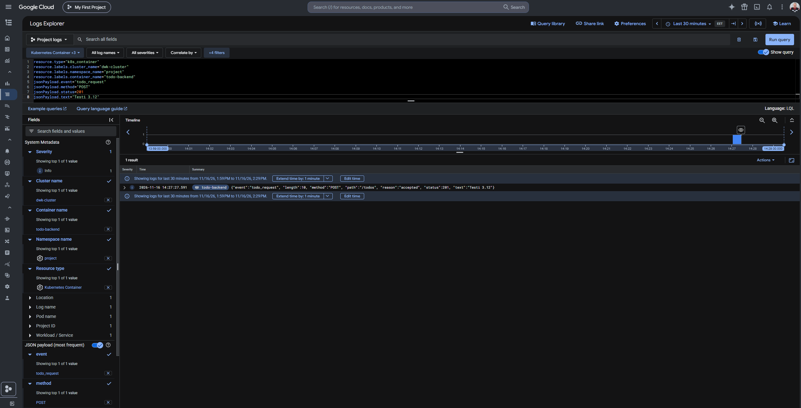

## 3.12 GKE monitoring

Tarkistin Todo Backendin sovelluslokit Google Cloudin Logs Explorerissa.
Rajasin kyselyn `dwk-cluster`-klusteriin, `project`-namespaceen ja
`todo-backend`-konttiin.

Lisäsin Todo Appissa tehtävän `Testi 3.12`. Lokimerkinnässä näkyivät
`POST /todos`, `reason: accepted` ja HTTP-status `201`, joka vahvisti
tehtävän luonnin.

### Logs Explorer -kysely

```text
resource.type="k8s_container"
resource.labels.cluster_name="dwk-cluster"
resource.labels.namespace_name="project"
resource.labels.container_name="todo-backend"
jsonPayload.event="todo_request"
jsonPayload.method="POST"
jsonPayload.status=201
jsonPayload.text="Testi 3.12"
```


