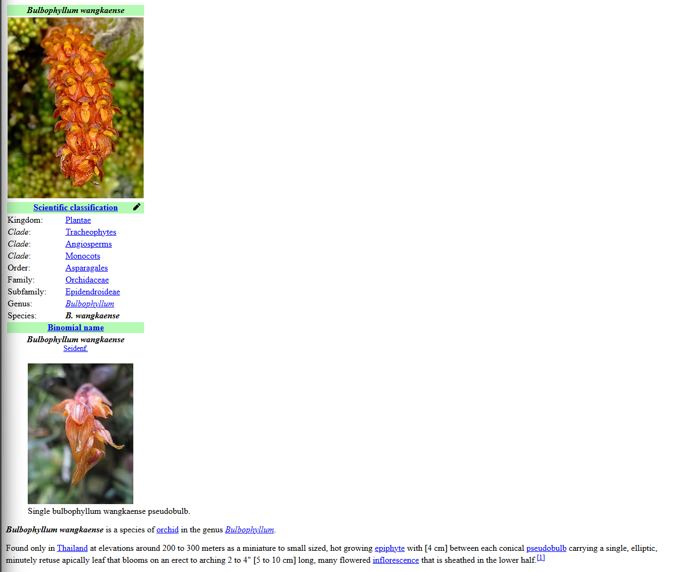

# 5.4 Wikipedia with init and sidecar containers

Sovellus tarjoilee Wikipedia-artikkeleita Nginxillä.
Init-kontti lataa ensimmäisen artikkelin ja sivukontti vaihtaa
artikkelin satunnaisen 5–15 minuutin odotuksen jälkeen.

## Toteutus

Samassa podissa on kolme konttia:

| Kontti | Tehtävä |
| --- | --- |
| fetch-initial-page | Init-kontti, joka lataa Kubernetes-artikkelin |
| nginx | Tarjoilee tallennetun HTML-sivun |
| refresh-page | Sivukontti, joka hakee satunnaisia artikkeleita |

Kontit käyttävät yhteistä `emptyDir`-volyymia hakemistossa
`/usr/share/nginx/html`. Nginx liittää hakemiston vain luettavaksi.

Init-kontti hakee sivun:

https://en.wikipedia.org/wiki/Kubernetes

Sivukontti arpoo jokaisella kierroksella 300–900 sekunnin
odotusajan ja hakee sen jälkeen sivun:

https://en.wikipedia.org/wiki/Special:Random

Curl seuraa uudelleenohjauksia varsinaiseen artikkeliin.
Lataus kirjoitetaan väliaikaiseen tiedostoon, joka korvaa
`index.html`-tiedoston vasta onnistuneen latauksen jälkeen.
Epäonnistunut lataus säilyttää aiemman sivun.

Skriptit liitetään podiin Kustomizen generoimasta ConfigMapista.

## Käyttöönotto

Sovellus käyttää paikallisen `istio-lab`-klusterin omaa
`wikipedia`-namespacea.

Suorita repositorion juuresta:

```powershell
kubectl --context=k3d-istio-lab apply -k wikipedia

kubectl --context=k3d-istio-lab -n wikipedia `
    rollout status deployment/wikipedia --timeout=300s
```

Valmiissa podissa näkyy `2/2 Running`.

Avaa port-forward:

```powershell
kubectl --context=k3d-istio-lab -n wikipedia `
    port-forward svc/wikipedia 8086:80
```

Sovelluksen osoite: http://localhost:8086

## Testaus

1. Sovelluksen ensimmäinen sivu oli Kubernetes-artikkeli.
2. Sivukontin lokissa näkyi satunnainen 490 sekunnin odotus.
3. Odotuksen jälkeen sivu vaihtui Bulbophyllum wangkaense
   -artikkeliksi.

Lokiseuranta:

```powershell
kubectl --context=k3d-istio-lab -n wikipedia `
    logs deployment/wikipedia -c refresh-page -f
```



Sovellus tallentaa HTML:n. Wikipedian tyylitiedostoja ei kopioida,
joten paikallisen sivun ulkoasu on alkuperäistä pelkistetympi.

## Windowsin rivinvaihdot

Shell-skriptit tallennetaan LF-rivinvaihdoilla.
Repositorion `.gitattributes` sisältää määrityksen:

```text
wikipedia/*.sh text eol=lf
```

Käyttöönotossa havaittu CRLF-rivinvaihtoihin liittynyt
init-kontin käynnistysvirhe korjattiin muuttamalla skriptit LF-muotoon.